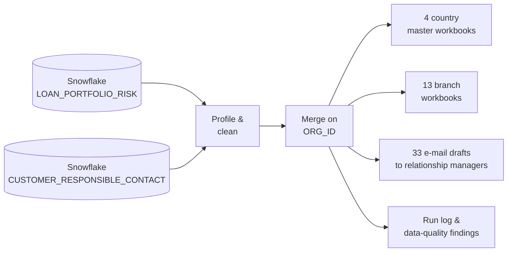
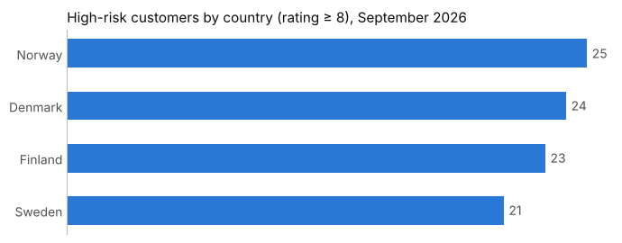

# Loan Risk Reporting Automation

**Snowflake → Python → country & branch Excel reports + relationship-manager e-mail alerts, in one run.**


> This project recreates a workflow I automated as a data analyst at a major Nordic bank. **All data is synthetic**: customers, employees, e-mail addresses (reserved `.example` domain) and phone numbers are generated. The logic mirrors the real process.

**👉 Start here: [the notebook](notebooks/loan_risk_reporting_pipeline.ipynb)** — every step is explained for a non-technical reader, with outputs shown.

---

## The problem

Each month, a credit risk monitoring snapshot of the corporate loan portfolio has to reach three audiences:

| Audience | Needs |
|---|---|
| Country management | One consolidated workbook per country |
| Each branch | Its own customers only |
| Relationship managers | An alert about their **high-risk** customers (rating 8–10) |

Done by hand, this meant exporting two tables, matching them in Excel, filtering and saving 17 files, and writing dozens of e-mails, with every manual step a chance to send the wrong data to the wrong branch.

## The solution



| Step | What happens |
|---|---|
| **Extract** | Query both tables directly from Snowflake into pandas (no manual exports) |
| **Profile** | Measure data quality first: duplicates, key mismatches, 16 spellings of 4 countries, mixed phone formats |
| **Clean** | Standardise keys, countries, e-mails and phone numbers (E.164); dedupe; keep the latest responsible per customer |
| **Merge** | Left join with `validate="one_to_one"` so duplicate keys stop the run instead of inflating numbers |
| **Report** | Formatted Excel per country and per branch; high-risk rows highlighted; reconciled so every customer is in exactly one branch file |
| **Alert** | One e-mail draft per relationship manager listing all their high-risk customers (drafts for human review, never auto-sent) |
| **Audit** | `run_log.json` with counts and every data-quality finding |

<p align="center">
  
</p>

See [`sample_output/`](sample_output/) for example Excel files and an e-mail draft.

## Design decisions

- **E-mails drafted in Python, not VBA.** A macro-enabled `.xlsm` copy of every report would double the files, duplicate the logic, and be blocked by default in Microsoft 365 for files from the internet. Python keeps one set of clean `.xlsx` files and the logic in one reviewable place. Drafts are written as `.eml` files (open as drafts in Outlook) or placed straight into Outlook's Drafts folder on Windows.
- **Fail loudly.** Unknown country values, invalid e-mails and duplicate join keys raise errors rather than being silently dropped.
- **Report what can't be fixed.** Customers with no responsible, or contacts for customers who have left, are listed in a *Data Quality* sheet and the run log so the data owners can correct the source.
- **Least privilege.** The notebook connects with a read-only Snowflake role; credentials live in a local `.env` file that is never committed.

## Repository structure

```
├── notebooks/
│   └── loan_risk_reporting_pipeline.ipynb   ← the end-to-end workflow, explained
├── sql/
│   ├── 01_setup_database.sql                ← warehouse, database, schemas, read-only role
│   ├── 02_create_tables.sql                 ← table DDL
│   ├── 03_load_data.sql                     ← stage + COPY INTO
│   └── 04_data_quality_checks.sql           ← profiling queries
├── data/raw/                                ← synthetic source data (CSV)
├── scripts/generate_mock_data.py            ← reproducible data generator (seeded)
├── sample_output/                           ← example Excel reports, e-mail draft, run log
├── docs/
│   ├── snowflake_setup_guide.md
│   └── github_publishing_guide.md
├── requirements.txt
└── .env.example
```

## Run it yourself

```bash
git clone https://github.com/Sigmund-Engeset/loan-risk-reporting-automation.git
cd loan-risk-reporting-automation
python -m venv .venv && source .venv/bin/activate      # Windows: .venv\Scripts\activate
pip install -r requirements.txt
jupyter lab notebooks/loan_risk_reporting_pipeline.ipynb
```

The notebook runs out of the box against the CSV files in `data/raw/`. To run it against Snowflake, follow [`docs/snowflake_setup_guide.md`](docs/snowflake_setup_guide.md), copy `.env.example` to `.env`, fill in your details and set `DATA_SOURCE=snowflake`.

## Next steps

- Schedule the run after the monthly snapshot lands (Airflow, or a Snowflake Task + Python stored procedure)
- Move cleaning logic into Snowflake views / a dbt model so Python only handles distribution
- `pytest` unit tests for the cleaning functions
- Distribute branch files via SharePoint folders with per-branch access instead of e-mail

---

**Sigmund Engeset** · Data analyst, Oslo · Power BI · SQL · Snowflake · Python · [GitHub](https://github.com/Sigmund-Engeset)
